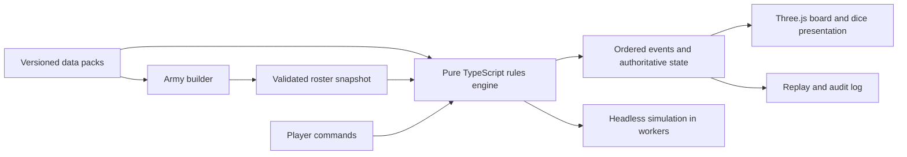

# Browser army builder, tabletop game, and simulator

Research date: 10 October 2026 (Asia/Kuala_Lumpur).

## Accepted direction: solo lab first

The user selected a personal sandbox instead of a two-player-first product. Each side has independent Manual, Assisted, or Basic Bot control. The player can take either side at the next decision boundary, or keep one army through the whole battle. Prior multiplayer-first recommendations below are superseded by this decision.

The first runnable implementation is `../solo-lab/`: a Three.js battlefield, editable training rosters, a staged dice tray with sound and pace settings, guided bot decisions, saved/restoreable seeded positions, JSON state export/import, and worker-based full-battle Monte Carlo trials. Its rules are explicitly experimental and simplified; the collected community data has not yet been converted into faithful playable army rules. Both sides currently use common training templates to isolate the sandbox mechanics.

Verified: eight headless engine tests, a production build, browser-assisted bot movements and attacks, checkpoint saving, round scoring, and a 500-trial browser simulation. Future work prioritizes reviewed real profiles and individual model geometry, then rules phases, rerolls, reactions, and richer experiment comparison. Multiplayer is deferred.

## Product direction

Build a guided digital tabletop. Preserve army composition, positioning, objectives, resource decisions, target selection, and dice uncertainty. Automate measurement, bookkeeping, eligible action discovery, and repetitive resolution. Token graphics are enough, but gameplay geometry must be explicit.

Three connected experiences should share one army format and one rules engine:

1. **Assemble:** pick faction, detachment, points cap, squads, sizes, loadouts, leaders, and enhancements. Show validation errors with specific fixes. Save and compare rosters.
2. **Play:** deploy tokens, take guided turns, choose attacks and reactions, roll visible dice, and capture objectives. Start with local two-player play.
3. **Lab:** compare weapon/loadout outcomes, replay a turn, sample combat outcomes, and eventually evaluate armies against several opponents and terrain layouts.

Use a faithful edition-specific mode and a separately named quick-play adaptation. Shorter matches should be an explicit design choice, with their own missions and balance; do not claim that squad tokens or altered activation orders reproduce official tabletop rules.

## Current sources and what was collected

The [official 11th-edition announcement](https://www.warhammer-community.com/en-gb/articles/nhqt9wx3/new40k-rules-download-the-free-core-rules-now/) identifies the new edition and links the core rules. Do not silently mix legacy 10th-edition rules into it.

The [official downloads hub](https://www.warhammer-community.com/en-gb/downloads/warhammer-40000/) links the Munitorum Field Manual and displayed **updated 30/09/2026** when checked. It describes points, leader attachments, detachment points, and force dispositions. The [interactive manual](https://mfm.warhammer-community.com/) could not be read with the web tool, so its actual faction values have not been verified here.

The [community BSData 11th-edition repository](https://github.com/BSData/wh40k-11e) provides JSON catalogues and libraries. GitHub API reported main at commit `cc58ee3b2c23f90af9d00e7bf234cd703b762299`, dated 9 October 2026. This research pins that commit instead of using a moving branch.

The collection contains **46 source files**, **7,438 numeric profile records**, and **2,977 unit/model selection records**. These are graph records, including variants and shared library content; they are not counts of distinct legal units or complete datasheets.

Files under `data/` retain unit/weapon names, identifiers, numeric characteristics, direct costs, source hashes, catalogue imports, and link references. Ability prose is omitted. They are research inputs, not validated game-ready rosters or executable rules. Every file was fetched and parsed successfully.

Coverage includes Space Marines and their chapter catalogues; Sororitas, Custodes, Mechanicus, Astra Militarum, Imperial Agents, Grey Knights and Imperial Knights; Chaos Space Marines, Daemons, Chaos Knights, Death Guard, Emperor's Children, Thousand Sons and World Eaters; Aeldari, Drukhari, Genestealer Cults, Votann, Necrons, Orks, T'au and Tyranids. Shared libraries, Titans, Legends, and unaligned entries are also inventoried. Repository presence is not proof that every current official entry is complete or correct.

Some faction catalogues contain no local numeric profiles because they import libraries. Flattening each file independently would lose their armies. A real importer must resolve catalogue links, entry links, shared profiles, selection groups, conditions, modifiers, and constraints.

### Data pipeline

Source discovery -> pinned inputs -> graph resolution -> normalized profiles -> roster validation -> executable behavior -> official-source review -> published rules pack.

Keep points, profiles, missions, geometry, and behavior as separately versioned components. A match pins all component versions at creation. Updates must not change a game in progress or invalidate old replays.

For each faction, report four distinct states: catalogued, roster-validatable, playable, and fully verified. Record unresolved links and unsupported abilities rather than silently dropping them. A missing ability can materially alter an army.

Abilities need reviewed implementations: timing, eligibility, effect, duration, cost, player choice, and stacking interactions. Text imported from a catalogue is not executable game logic. Each implemented behavior needs a focused rules scenario. Unsupported behavior should prevent a faithful-mode claim for that roster; a sandbox may allow an explicit recorded adjudication.

Base sizes, vehicle footprints, vertical occupancy, and visibility proxies need a separate geometry dataset. A flat circle alone cannot reproduce model-based visibility. Faithful token play should declare the approximation and provide adjudication where needed.

## Make the tabletop easier

### Board and tokens

Use a top-down camera by default and optional tilted view. Render low cylinders with faction colour, role icon, short name, wounds, selection ring, and status marks. Vehicles use declared footprints. Simple extruded terrain can communicate blocked movement, height, and cover.

Keep **one token per model** in the simulation. Select a whole squad and drag a formation ghost for convenient movement. Validate every model's path, travel distance, final position, and coherency before committing. Allow individual adjustment when placement matters. A single squad disc belongs only in an explicitly simplified mode.

Hovering a model explains the relevant distances and visibility decision. Keep game coordinates in a declared tabletop unit system, with integer subunits where practical, and convert to rendering coordinates at the view boundary.

### Guided interaction

The selected rules pack owns turn structure. The interface highlights legal actions, shows an action preview, then asks for the relevant player choices. Automatically track round, phase, resources, wounds, status, and objective scoring.

Example attack interaction:

1. Select an eligible unit and choose its weapon groups.
2. Select legal targets; allow split fire where supported.
3. Inspect range, visibility, modifiers, and target eligibility explanations.
4. Confirm the attack and resolve its dice groups.
5. Pause at legal reactions, rerolls, allocation decisions, and other interrupt windows.
6. Apply casualties and update the event log.

Automation must not make tactical choices for the player. Casualty removal, variable defensive profiles, resource spending, and target splitting may change outcomes. Only fast-roll attacks where the rules and allocation state permit equivalent grouped resolution.

Movement can be undone before commitment. Once hidden information is revealed or dice resolve, any reversal should require an explicit agreed correction and remain in the log.

## Make dice the central spectacle

Present resolution as visible stages: attacks generated -> hits -> wounds -> saves -> damage. Stage names and extra checks follow the selected edition and abilities.

- **Tactile launch:** drag a dice cup or press/hold Roll, with spatial audio and a short throw animation. Gesture strength affects the presentation only.
- **Readable results:** successful dice group together; misses fade; show both individual faces and totals. Use icons as well as colour.
- **Critical moments:** give unusually consequential rolls a brief close-up, impact sound, and optional slow reveal. Avoid slowing every ordinary volley.
- **Player decisions:** highlight precisely which dice may be rerolled, the cost, and the legal decision window. Preserve original and replacement results.
- **Defender participation:** let the defending player initiate their saves, with an optional auto-roll setting for pace.
- **Pace controls:** Cinematic, Quick, and Instant modes, plus reduced motion and independent volume controls. Large batches may animate a sample while displaying the complete recorded results in the tray and log.
- **Clear causality:** show which weapon group produced each dice pool and which rule changed a result. Do not turn a critical-looking face into a special effect unless that weapon's rules support it.

Resolve authoritative random results independently from Three.js animation. For online play, generate unbiased integer outcomes on the server and record every draw, grouping, reroll, and resulting event. Animate the recorded outcome. Uncontrolled client physics should not decide multiplayer results.

For replay and simulation, accept injected deterministic random streams. A seed alone is insufficient: pin PRNG algorithm, engine version, rules pack, and draw order. Competitive fairness may later use a reviewed commit/reveal protocol; reproducibility alone does not prove fairness.

The satisfying rhythm is: **choose a risk -> see the stakes -> roll -> react -> make the next legal decision**. Avoid extra minigames that change dice probabilities in faithful mode.

## Architecture

Use TypeScript with a small web development setup, a DOM interface for cards/panels, and Three.js for board and dice. [Three.js documentation](https://threejs.org/docs/) provides the rendering API; instanced meshes are a sensible approach for repeated tokens. Keep rendering independent from rules, so thousands of combat samples can run without drawing a board.

Core modules: data importer; rules-pack registry; roster validator; geometry queries; command validation; resolution queue; reaction windows; random source; event log; scoring; renderer; simulation worker. Start local, then add an authoritative WebSocket server for multiplayer. The client sends intentions, not final damage or unrestricted state changes.

Model the rules engine as commands producing ordered events and state changes. An effect queue must suspend and resume for player decisions and reactive abilities. Keep presentation state outside authoritative battle state.

## Simulation scope

First implement combat analysis for selected supported profiles: expected damage, full outcome distribution, kill probability, resource costs, and reroll decisions. Show confidence intervals for Monte Carlo estimates and distinguish them from exact calculations.

Next, replay snapshots and test alternative targeting or movement decisions using the same seed for comparison. Full army-strength evaluation needs opponents, terrain, missions, and a stated bot policy; isolated damage per point is not an overall win-rate estimate.

Bot development should start with legal-action enumeration, objective priorities, movement candidates, and a simple scored policy. Do not make a language model the authoritative rules referee.

## Implementation sequence and acceptance

1. **Data foundation:** resolve two factions end to end and build rosters against reviewed current values. Fail on unresolved required references and unsupported constraints. Add broader army-builder coverage gradually.
2. **Play slice:** two supported factions (proposed Space Marines and Orks), one explicitly defined training mission, small armies, per-model tokens, movement, shooting, melee, casualty choices, scoring, and a full visible dice sequence. Target a 20–30 minute training experience; this is a product target, not an official game duration.
3. **Lab:** headless combat sampling, outcome histograms, versioned snapshots, and deterministic replays.
4. **Multiplayer:** shared board, server validation and randomness, reconnect/resume, explicit reaction deadlines, and recorded corrections.
5. **Breadth:** implement leaders, transports, reserves, faction resources, detachments, stratagems, and mission interactions as the supported roster set expands.

Validate probability boundaries and rerolls; geometry at range/coherency edges; interrupt ordering; damage allocation across differently equipped models; roster conditions; replay determinism; and server rejection of illegal commands. Dice animation must finish on the recorded face, including reduced-motion mode. A full match should replay to the same final state from its initial snapshot and event stream.

The first successful milestone is a short match that players want to replay. A complete catalogue alone does not establish that the game is fun or faithfully automated.

## Open decisions

Default proposal: guided faithful foundations with an explicitly separate short training mode; Space Marines versus Orks first; local two-player first; individual model tokens with squad movement tools; lab before sophisticated AI; all-faction catalogue breadth before claiming all-faction playable support.

This deliverable is research, a factual data snapshot, and an implementation design. It does not yet include a runnable browser game, a fully resolved roster validator, or a complete official datasheet/rules corpus.
